<div align="center">

  <a href="https://ascii.rest/kyoto-dusk/">
    <picture>
      <source media="(prefers-reduced-motion: reduce)" srcset="./assets/kyoto-dusk.png" />
      
    </picture>
  </a>

</div>

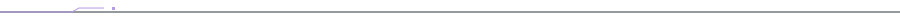

<a name="about"></a>

## 01 / Behind the handle

I'm **Sin** — a developer and cybersecurity enthusiast drawn to what happens beneath the interface.

I build with **Rust, Python, JavaScript and Bash**, explore artificial intelligence, and learn security through experimentation. From software and local models to vulnerabilities and system internals, I like turning questions into something I can test.

> **Don't just use technology. Understand it.**

<details>
<summary><code>$ cat about_me.py</code></summary>

```python
class SinOmega:
    interests = ["Development", "Cybersecurity", "Artificial Intelligence"]
    languages = ["Rust", "Python", "JavaScript", "Bash"]
    mindset = "Understand how things work."
    objective = "Build. Explore. Improve."
```

</details>

<br />

## 02 / Three domains. One mindset.

<p align="center">
  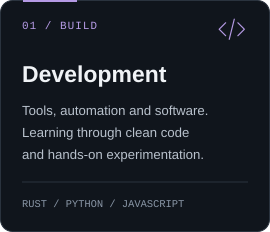
  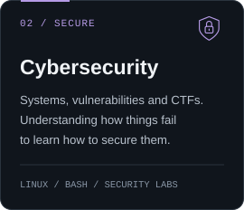
  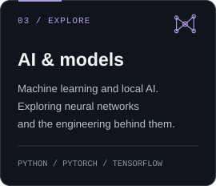
</p>

<a name="stack"></a>

## 03 / Tools of the trade

### Languages

<p>
  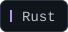
  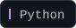
  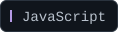
  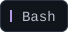
  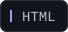
  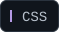
</p>

### AI exploration

<p>
  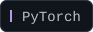
  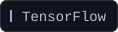
</p>

### Tools & technologies

<p>
  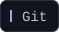
  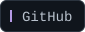
  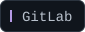
  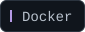
  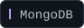
  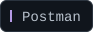
  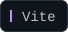
  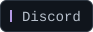
</p>

<br />

<a name="security"></a>

## 04 / Security lab

Learning through **CTFs, hands-on challenges and authorized labs** — understanding the system, finding the weakness, and learning why it exists.

<p align="center">
  <a href="https://tryhackme.com/p/Hearthbleed">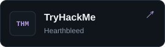</a>
  <a href="https://www.root-me.org/sin-omega">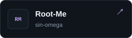</a>
  <a href="https://www.hackthebox.com/">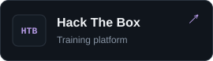</a>
</p>

<!-- Replace the Hack The Box website URL above with your public profile URL when available. -->

<br />

## 05 / Activity

<details>
<summary><strong>Open GitHub statistics & contribution activity</strong></summary>

<br />

<p align="center">
  <a href="https://github.com/siinomega"></a>
  <a href="https://github.com/siinomega"></a>
</p>

<p align="center">
  <a href="https://github.com/siinomega"></a>
</p>

<p align="center">
  <sub>Language usage reflects repository code, not a proficiency ranking.<br />Statistics are provided by external services and may be cached or temporarily unavailable.</sub>
</p>

</details>

<br />


<div align="center">

  

  <h3>Stay curious. Keep building.</h3>

  <p><sub>Development &nbsp; / &nbsp; Cybersecurity &nbsp; / &nbsp; Artificial Intelligence</sub></p>

  <a href="https://github.com/siinomega"><sub>@siinomega</sub></a>

</div>
